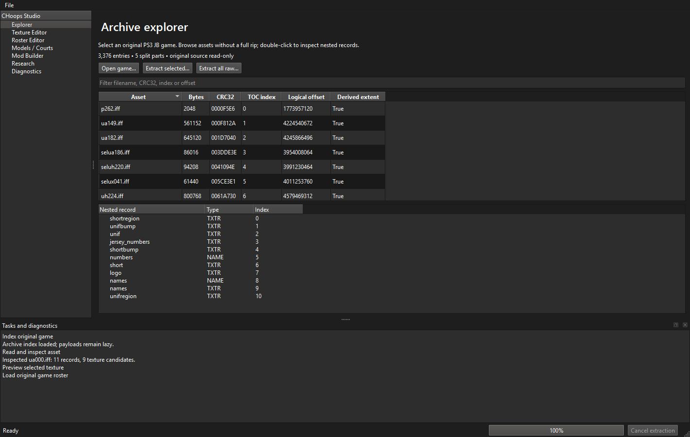

# CHoops Modding Studio — development rebuild

v1.11 roster editing uses selected-record side panels for every category, with
integrated palettes, footwear, player school assignment and combined jersey/shorts
preview controls. [Guide and evidence](docs/ROSTER_SIDE_PANELS.md).

Native PySide6 desktop tools for PS3 College Hoops 2K8: lazy archive/nested-record browsing, raw extraction, DDS preview/export/import, confirmed roster fields, replacement-folder staging and separate JB builds. The source game remains read-only.

The full mandate remains incomplete. Start with [current status](docs/CURRENT_STATUS.md), [secondary Codex prompt](docs/SECONDARY_CODEX_PROMPT.md), [collaboration](docs/COLLABORATION.md), and [test report](docs/TEST_REPORT.md). Development releases use the v1.0x train; check GitHub for the latest tag.

```powershell
python -m venv .venv
python tools/dev/setup.py
.\.venv\Scripts\python.exe -m choops_py.studio
.\.venv\Scripts\python.exe -m choops_py.cli --help
```

Open the original JB/USRDIR in Explorer, double-click an asset, inspect/preview textures, save compatible edited copies, and stage them through Mod Builder. Prepared overrides and exports belong under output/. Mod Builder can write the completed JB to a manually selected empty folder on any drive, with source and overwrite protections. No Node or HTTP server is required.

Local verification exercised read-only real inputs and separate generated outputs; environment-specific measurements are excluded from public documentation. Unknown formats stay read-only/unavailable, and runtime testing is NOT RUN.

DDS import, export and texture previews use built-in conversion; separate converter executables are unnecessary. Historical converters are used only for optional local comparisons and are excluded from Windows packages; [provenance](docs/rebuild/CONVERTER_PROVENANCE.md).

Recursive staging automatically restores non-stadium artwork to the selected base JB's texture layouts. Models / Courts can prepare a reusable single-surface court from a supplied template ZIP, retaining only the full-court color texture and a correctly routed bump texture. See [court preparation and resolution limits](docs/SINGLE_SURFACE_COURT.md). Static verification does not establish a crash-free gameplay resolution.

See [user guide](docs/USER_GUIDE.md), [development](docs/DEVELOPER_GUIDE.md), [format evidence](docs/FORMAT_SPECIFICATIONS.md), [performance](docs/PERFORMANCE.md), [architecture](docs/rebuild/ARCHITECTURE.md) and [acceptance gates](docs/rebuild/ACCEPTANCE_TESTS.md). Historical tags/docs remain preserved and must not be read as current proof.



The experimental [Audio workspace](docs/AUDIO_WORKFLOW.md) provides separate
Licensed Music and Fight Songs views, WAV export/replacement preparation and
mapped cover-art actions. Song-title editing is unavailable and EBOOT remains
read-only. The standalone Windows package includes restricted LGPL audio helpers
with corresponding source archives and license notices; Windows CI has verified
the packaged WAV round trip on the current development branch.
Both Codex instances maintain documentation and submit each update through a PR;
[AGENTS.md](AGENTS.md) defines the shared rules.


### Shared PS3 2K sources (v1.17)

The editor now auto-detects the verified College Hoops and NBA 2K9 archive layouts
for extraction, authored previews and source-format rebuilding. College Hoops 2K8
roster features remain specific to that game. Other titles require verification;
unknown layouts fail explicitly. See [shared format evidence and commands](docs/PS3_2K_ARCHIVES.md).
Included in the official v1.17 Windows release.

### NBA roster and NBA 2K14 extension (unreleased)

See [verified NBA editing and container support](docs/NBA_ROSTERS_AND_2K14.md) and
[animation portability research](docs/ANIMATION_PORTABILITY.md). NBA 2K14 reads
SDAT sources directly; authenticated JB rebuilding and combined jersey previews
remain unsupported. Roster editing dispatches by payload schema; unconfirmed NBA
fields remain read-only. These changes are newer than Windows v1.17.
